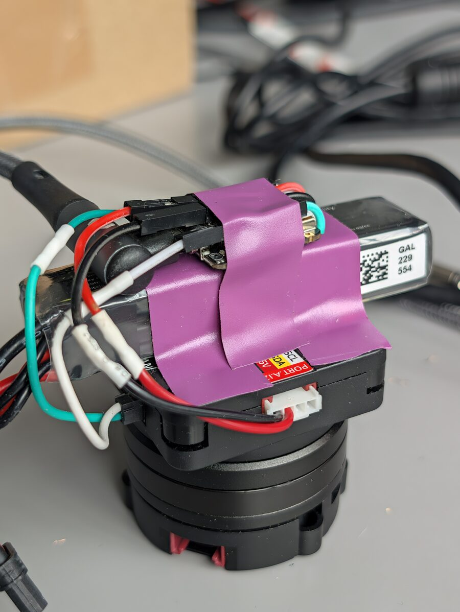

# can-do-gyro

A self-righting platform built with the Seeed Studio
[XIAO STM32C5](https://wiki.seeedstudio.com/xiao_stm32c5_getting_started/): its on-board IMU tracks the platform's
orientation in 3D, and over CAN it drives a BLDC motor that turns the base against every disturbance. However you turn
the bottom, the top keeps facing the same direction in the room. It works standing upright, tilted, sideways and
upside down.

<p align="center">
  
</p>

An M5Stack [Unit RollerCAN](https://docs.m5stack.com/en/unit/Unit_RollerCAN) stands on its motor: the round rotor is
the bottom, on the table. On its body sit a small 2S LiHV battery and the XIAO. The XIAO is on the part that has to stay
still, so it measures its own correction: a closed loop on the gyro, running at about 1 kHz.

## How it came about

I was looking for something to build with the XIAO STM32C5 and noticed two things on the board: an IMU
(accelerometer and gyro), and CAN with the transceiver on board, its killer feature. What can you do with knowing your
orientation and being able to talk to a motor? I had always wanted to try a BLDC motor, so: a gimbal in one axis. The
XIAO rides on the motor, and however you turn it, the top keeps facing the same direction.

The motor was an easy pick: the RollerCAN is a complete BLDC unit (motor, FOC driver, encoder) that takes its commands
over CAN. I soldered DuPont pigtails to the XIAO's CAN pads and to 5V and GND and glued them down, so everything plugs
in and out. The RollerCAN ran from a bench supply at first, then from a LiPo plugged straight into it, and the unit
became standalone. After some tuning it held the way I had in mind, and with orientation tracking in 3D it no longer
matters how the motor and the XIAO are oriented.

It shows how the XIAO STM32C5 can drive a CAN motor with everything, from the sensor fusion to the control loop,
computed on the chip.

## Why the XIAO STM32C5

Everything this needs is on the thumb-sized board, so the whole controller is the XIAO plus four wires:

- **CAN with an on-board transceiver**: the STM32C5A3CG has two FDCAN controllers; one is wired to a TI TCAN3403 with
  CANH/CANL pads and a 120 Ω termination (on as delivered). Two wires go to the motor. The RollerCAN only
  speaks classic CAN 2.0, so this uses 1 Mbit/s classic frames; the controller can do CAN FD.
- **On-board 6-axis IMU** (LSM6DS3TR-C, I2C): gyro at 416 Hz through its FIFO, every sample used.
- **Cortex-M33 at 144 MHz with FPU**: a quaternion update per gyro sample, the control law and CAN traffic every loop
  leave most of the time asleep (the loop takes ~0.5 ms of work).
- **1 MB dual-bank flash**: the firmware runs from bank 1 and records ~30 s of telemetry into bank 2 while it runs,
  without stalling, so you can see afterwards what it did standalone on the battery.
- **Native USB**: serial console for commands and status, and drag-and-drop UF2 flashing.

## Hardware

- Seeed Studio XIAO STM32C5
- M5Stack Unit RollerCAN (STM32G431 + DRV8311 FOC driver, D3504 200 KV gimbal motor, magnetic encoder, 6–16 V on
  XT30)
- A 2S LiHV battery (580 mAh used here, 7.6 V nominal) with an XT30 plug
- Female DuPont pigtails, soldered to the XIAO's CANH/CANL pads and 5V/GND and glued down on top with superglue, so
  CAN and power plug in and out
- Something to hold battery and XIAO on the RollerCAN's body (tape works)

Wiring:

The RollerCAN's XT30 (2+2) connector carries both power and CAN:

- Battery on its power pins.
- XIAO **CANH / CANL** pads to its CAN_H / CAN_L pins (the ground is shared through the Grove cable).
- XIAO **5V** and GND from the RollerCAN's Grove port, so it runs standalone without USB.

The XIAO can sit at any angle: calibration takes the motor axis from gravity. Mounted here: the battery lies flat on
the RollerCAN's body, the XIAO is taped flat on the battery.

RollerCAN settings (in its own screen menu): communication **CAN**, **1 Mbit/s**, ID **0xA8** (168, the default),
stall protection on. Leave the PID preset at the default: the stiffness the firmware sends only applies there. The
firmware doesn't save anything on the RollerCAN.

## Build and flash

The STM32C5 has no Arduino core yet, so this is a [Zephyr](https://zephyrproject.org/) application, built with
[PlatformIO](https://platformio.org/) and Seeed's platform (pinned to a tested commit in `platformio.ini`, installed by
the first build):

```
pio run -e xiao -t upload
```

That resets the XIAO into its UF2 bootloader (1200-baud touch) and copies the firmware to its USB drive `XIAOC5BOOT`,
which has to be mounted (desktops do that by themselves). If the firmware hangs and the reset doesn't work,
double-tap the XIAO's reset button and upload again.

`platformio.ini` also pins a newer ARM GCC (12.3) than the platform asks for: the requested 8.2.1 has no Linux ARM64
build.

## Using it

1. Put it upright on the table, plug in the battery, and keep it still for 2 s: it measures the gyro's offset and the
   motor axis. If it moves, it says so and tries again.
2. From then on it holds: the top keeps facing the direction it faced when holding started. Turn the bottom, pick it
   up, tilt it: the motor turns the top back.

The green LED blinks once a second while all is well, and fast while the RollerCAN or the IMU is missing.

Serial commands (USB, 115200, e.g. `pio device monitor`), one per line. Anything else on a line is ignored without an
answer, so a terminal that echoes the XIAO's own output back (Linux does until the port is raw) can't start the motor.

| Command | What it does |
| --- | --- |
| `h` | hold: the top keeps the direction it faces now |
| `s` | motor off (turns freely) |
| `c` | calibrate the gyro again (upright and still for 2 s), then hold |
| `p <mA/°>` | stiffness, 5 to 100, until reset |
| `d <ms>` | damping, 0 to 500, until reset |
| `f` | flip the motor direction until reset |
| `i` | status: deviation, rotor, current, voltage, temperature, gyro offset, tilt, loop timing, battery, recording |
| `dump` | print the recording (motor off meanwhile), see below |
| `erase` | clear the recording; the next boot records |
| `?` | list the commands |

## How it works

- **Orientation**: a quaternion integrated from all three gyro axes, with its tilt pulled towards gravity whenever the
  accelerometer reads about 1 g (Mahony-style, ~2 s time constant). The accelerometer can't see the heading, so that
  comes from the gyro alone.
- **Facing**: a vector across the motor axis is the top's front. The motor can only turn the top about the motor axis,
  so the target is the original direction projected across the motor axis, and the deviation is the signed angle
  between front and target about it. Counting only the gyro's turn about the motor axis would miss what tilting,
  turning and tilting back does (in a simulation, 20 tilt circles of 20° turned the top −12.7°, the single axis
  counted −141°). Within 15° of the motor axis pointing at the original direction, turning can't help; afterwards it
  holds the direction it faces then.
- **Control**: every loop, the rotor's target = where the rotor is now − (deviation + turning rate × damping +
  integral). The RollerCAN's own position controller pushes with the stiffness (mA per degree) towards it, up to
  500 mA. The XIAO sends the target and the next position request without waiting for the answers, which it picks up
  at the next loop.
- **Integral**: a deviation that stays makes the push grow until the motor breaks free of its friction (~50 mA) and
  turns the top back; capped at 300 mA.
- **Standing still**: every 1/4 s with the gyro within 2.5 °/s of its offset counts as standing still. That time
  isn't integrated and the offset follows the gyro, so the direction doesn't drift at rest.
- **Never gives up**: no turn limit (the RollerCAN counts ~59,000 turns), the top more than 90° off (held by hand)
  makes its current direction the new one, and after the RollerCAN's stall protection (blocked ~3 s) it holds again
  after 3 s. Only an empty battery switches the motor off.

## Settings

Defaults in `src/main.c`, tuned by hand and from recordings, standalone on the battery:

- **Stiffness 15 mA/°** (`POSITION_KP`): at 10 the top lagged 4–7° while turning the bottom by hand. At 20 and 25 it
  holds tighter (3.6 and 2.1° RMS instead of 4.1°), but 25 buzzes at 50 Hz and 20 once ran off at rest.
- **Damping 100 ms** (`DAMPING_MS`): 50 overshot after fast turns.
- **Integral 4 s** (`INTEGRAL_S`): 1.5 s overshot by more than 90°.
- **Gyro 416 Hz**: at 104 Hz its readings come ~15 ms late and the unit wobbled at ~17 Hz. 416 Hz is noisier
  (~3.7 °/s RMS) but held best.
- **Loop ~1 ms** (`LOOP_US` 500 µs sleep; IMU 0.3 ms, CAN 0.1 ms).
- **Max current 500 mA** (`MAX_CURRENT_MA`): the motor's continuous rating without cooling, so it can even stay
  blocked. The RollerCAN's factory limit is 1000 mA.

## Recording

To see what it does standalone, without USB. From boot, every loop writes the time, the top's turning rate and
deviation, the rotor position, the motor current, the tilt and flags to the XIAO's flash (the unused OTA slot in bank
2, 480 KB: ~30 s, then it stops). A recording survives resets, power off and reflashing; a boot only records when
there is none.

1. `erase` over USB, unplug USB.
2. Power it up on the battery and let it run.
3. Unplug the battery (the XIAO powers off, the recording stays), plug in USB.
4. `python log.py rec.csv` (needs pyserial, PlatformIO's Zephyr Python has it:
   `~/.platformio/penv/.zephyr-4.4.0/bin/python`).

CSV columns: `t_s, rate_dps, turned_deg, rotor_deg, current_ma, tilt_deg, holding, new_gyro, still, sent`.

## Battery

The RollerCAN measures the battery at its input (no diode in between, good to about ±2%: compare `i` with a multimeter
once). The firmware averages it over ~10 s, so a short dip under load doesn't count (`BATTERY_*`, `CELL_*`):

- 3.82 V per cell (about 30% left) or less: "battery low" on serial every 30 s, the RollerCAN's LEDs orange. For a
  normal LiPo (4.20 V full) use 3.77 V and adjust the table in `batteryPercent()`.
- 3.50 V per cell or less: motor off, LEDs blink red. Unplug the battery then: the RollerCAN keeps drawing current, and
  a LiPo is damaged below 3.0 V per cell.
- Once the battery is above 30% again (charged or swapped), it holds again by itself.

With the battery unplugged, USB feeds the RollerCAN back through the Grove 5V (it reads ~4.8 V: "battery empty", motor
off).

## Limits and safety

- The RollerCAN enforces the 500 mA limit. Supply max 16 V.
- If the XIAO stops sending (unplugged, reset), the RollerCAN keeps its last target: its protocol has no timeout.
- The motor can turn the bottom fast when the top is held: keep cables clear.

## Notes on the XIAO STM32C5

Things learned along the way, in case they save you time:

- **CAN**: Zephyr's FDCAN driver with the on-board transceiver (its standby pin is handled by `can-transceiver-gpio`).
  Set `CONFIG_CAN_INIT_PRIORITY=80` as in Seeed's examples, so CAN starts after the GPIOs. The M_CAN controller has
  no one-shot mode: frames nobody acknowledges (motor unpowered) stay queued and block the TX buffers, so
  `can_stop()` / `can_start()` before looking for the motor again.
- **USB serial**: Zephyr's CDC ACM (`device_next`). Read it with the interrupt API: with `uart_poll_in()` only, no
  receive is ever queued and writes from the host hang.
- **Stack**: the default 2 KB main stack overflowed silently once printk got many floats (the board hung, no USB, the
  1200-baud reset dead: double-tap reset). 8 KB here.
- **IMU FIFO**: read it in one burst: with address auto-increment the LSM6DS3TR-C rolls from `FIFO_DATA_OUT_H` back
  to `_L`. Reading only the newest sample each loop skips samples at the phase of the loop's own jitter, and that adds
  up to drift. Count each sample for the gyro's measured sample period, not the loop's time.
- **IMU block data update**: with BDU on, reading the accelerometer's registers alone left the FIFO's gyro samples
  ~6 °/s off on one axis. Off, the accelerometer can be read alone and less often.
- **Gyro offset**: it changes by up to ~3 °/s depending on whether the motor's supply is on, and wanders with
  temperature, so calibrate with everything powered as it will run. The board has a heater around the IMU for
  temperature regulation; this project doesn't use it yet.

## Known issues

- **Slow drift standalone**: on the battery, without USB, the gyro reads much noisier at rest (±20 °/s per sample
  instead of ±2 on USB), so the standing-still check rarely passes, the offset isn't corrected, and the top slowly
  turns. Suspected: the XIAO's supply from the RollerCAN's Grove 5V. On USB plus battery it holds within 0.4° per
  minute.
- **Loops faster than 1 ms** (shorter `LOOP_US`) made the tilt estimate go wrong and the motor run off. Not
  understood yet.

## What else it could be

Anything that has to keep pointing one way on something that turns:

- **Hubcaps that stand still** while the car drives. On a wheel the motor axis lies flat, where the accelerometer sees
  the angle too, so it wouldn't drift. The motor would have to keep up with the wheel, though: about 14 turns per
  second at 100 km/h.
- **A Predator costume**: a shoulder cannon that stays aimed while you turn and walk, with a laser pointer on it.

## License

MIT, see [LICENSE](LICENSE).
