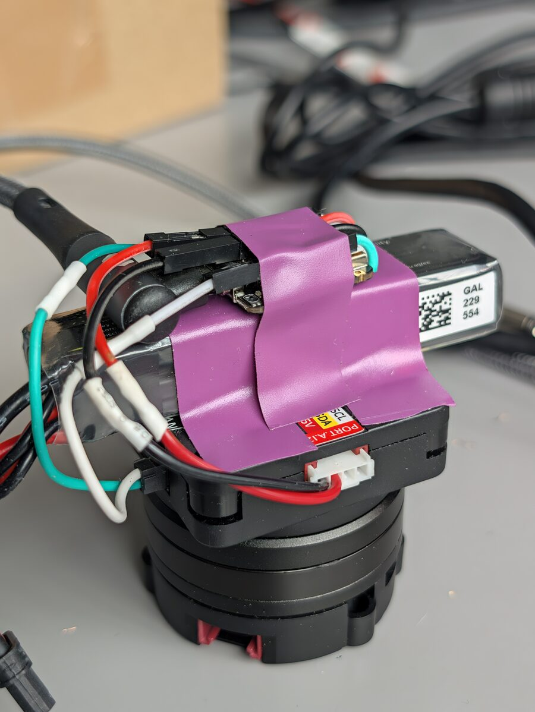

# Hackster.io post

The write-up for [hackster.io](https://www.hackster.io/), by field. The story below goes into the editor's Story;
upload the images where they are referenced.

| Field | Content |
| --- | --- |
| Name | can-do-gyro: A Self-Righting Platform with the XIAO STM32C5 |
| Elevator pitch | The XIAO STM32C5's on-board IMU and CAN drive a BLDC motor: however you turn the base, the top keeps facing the same way. |
| Cover image | `docs/photo.jpg` |
| Difficulty | Intermediate |
| License | MIT |
| Code | https://github.com/cpietsch/can-do-gyro |
| Schematics | the wiring list below |

**Things used in this project**

Hardware components:

- Seeed Studio XIAO STM32C5 ×1
- M5Stack Unit RollerCAN ×1
- 2S LiHV/LiPo battery with an XT30 plug (580 mAh here) ×1
- Female DuPont pigtails, a Grove cable, wire for the RollerCAN's XT30 (2+2) port

Software apps and online services:

- Zephyr RTOS (4.4)
- PlatformIO

Hand tools and fabrication machines:

- Soldering iron
- Superglue
- Tape

---

# Story

*(the 40 s demo video here)*

## The idea

I was looking for something to build with the new XIAO STM32C5 and noticed two things on the board: a 6-axis IMU
(accelerometer and gyro), and CAN with the transceiver right on the board. CAN is the killer feature: two wires, and
the XIAO talks to motors, drives and the rest of the CAN world.

So what can you do with knowing your orientation and being able to talk to a motor? I had always wanted to try a
brushless (BLDC) motor, so: a gimbal in one axis. The XIAO rides on the motor, and however you turn it, the top keeps
facing the same direction.

Picking the motor was quick: M5Stack's Unit RollerCAN is a complete BLDC unit (gimbal motor, FOC driver, magnetic
encoder and a small screen) that takes its commands over CAN.

## Building it



The RollerCAN stands on its motor: the round rotor is the bottom, on the table. On its body sit the battery and the
XIAO, on the part that has to stay still.

1. **The XIAO**: I soldered female DuPont pigtails to the CANH/CANL pads and to 5V and GND and glued them on top of the
   XIAO with superglue. That way CAN and power plug in and out, and the XIAO is still easy to use on the desk.
2. **Power**: at first I built a cable to run the RollerCAN from a bench power supply. Later a small 2S LiPo went
   straight onto the RollerCAN's XT30, and the unit was standalone.
3. **Wiring**: the RollerCAN's XT30 (2+2) connector carries power and CAN. The battery goes on its power pins, the
   XIAO's CANH/CANL on its CAN_H/CAN_L pins. The XIAO gets 5V from the RollerCAN's Grove port, so it
   doesn't need USB.
4. **Mounting**: the battery (71 × 15.5 × 13.5 mm) lies across the RollerCAN's 40 mm body, the XIAO on the battery, all taped down. The XIAO can
   sit at any angle: when it calibrates, the firmware takes the motor axis from gravity.

On the RollerCAN itself (its screen menu): communication CAN, 1 Mbit/s, ID 0xA8 (the default), default PID preset.

## The firmware

There is no Arduino core for the STM32C5 yet, so this is a Zephyr application, built with PlatformIO and Seeed's
platform. Everything runs on the XIAO, about once per millisecond.

### Talking to the RollerCAN

CAN needs almost no setup: the board's devicetree already describes the FDCAN controller and the TCAN3403 transceiver
with its standby pin. `CONFIG_CAN=y` is enough, plus `CONFIG_CAN_INIT_PRIORITY=80` so CAN starts after the GPIOs. The
RollerCAN only speaks classic CAN 2.0, so this runs at 1 Mbit/s with classic frames, although the controller can do
CAN FD.

The RollerCAN's protocol is simple: an extended ID with the frame type, sender and receiver, and 8 data bytes with a
parameter index and a value.

```c
static void transmit(uint8_t type, uint16_t index, int32_t value, k_timeout_t timeout) {
  struct can_frame f = {
      .id = (uint32_t)type << 24 | HOST_ID << 8 | ROLLER_ID,
      .dlc = 8,
      .flags = CAN_FRAME_IDE,  // extended ID
  };
  memset(f.data, 0, sizeof f.data);
  sys_put_le16(index, f.data);                // parameter, e.g. 0x7016: target position
  sys_put_le32((uint32_t)value, f.data + 4);  // its value, e.g. degrees x100
  can_send(can, &f, timeout, txDone, NULL);
}
```

The RollerCAN runs in position mode: it takes a target angle, and its own controller pushes towards it with a current
proportional to the error (the stiffness, in mA per degree), capped at 500 mA.

### Knowing where the top faces, in 3D

The IMU's gyro (LSM6DS3TR-C) runs at 416 Hz into its FIFO. Every loop reads all new samples in one burst and
integrates each one into a quaternion. Whenever the accelerometer reads about 1 g, the tilt is pulled slowly towards
gravity (Mahony-style); the heading comes from the gyro alone.

My first version only counted the gyro's turn about the motor axis. That works upright, but tilting, turning and
tilting back fools it: in a simulation, 20 tilt circles of 20° turned the top by −12.7°, and the single axis counted
−141°. With the full 3D orientation, the top's front is a vector across the motor axis, and the deviation is the angle
between it and the original direction, about the motor axis. Now it works upright, tilted, sideways and upside down.

### Holding

Every loop, the XIAO gives the rotor a new target:

```c
// where the rotor is now, minus how far the top is off, its turning rate times
// the damping, and the integral (in 1/100 degrees)
transmit(TYPE_WRITE, P_POSITION,
         actual - lround((turned + integral + rate * dampingMs / 1000) * 100), K_MSEC(2));
transmit(TYPE_READ, P_ACTUAL_POSITION, 0, K_MSEC(2));  // the answer is picked up next loop
```

- It doesn't wait for the answers: it sends the target and the next position request and picks up the answer in the
  next loop. Waiting would cost a CAN round trip every loop.
- The integral makes a deviation that stays push harder, until the motor breaks free of its friction (~50 mA).
- When the gyro stays within 2.5 °/s of its offset for 1/4 s, the unit counts as standing still: the offset follows
  the gyro, so the direction doesn't drift at rest.
- It never gives up: held by hand more than 90° off, it takes its current direction as the new one, and after the
  RollerCAN's stall protection it holds again after 3 s.

### A flight recorder in the second flash bank

Tuning a standalone unit is hard when you can't watch it, and with USB plugged in it doesn't behave quite the same. The
STM32C5 has 1 MB of dual-bank flash, and the firmware only needs the first bank. So from boot, every loop writes 16
bytes into the second bank: time, turning rate, deviation, rotor position, motor current, tilt and some flags. That's
~30 s, written while the loop runs, without stalling it. Afterwards `dump` over USB and a small Python script turn it
into a CSV. Most of the tuning below came from these recordings.

## Tuning

Stiffness, standalone on the battery, turning the bottom by hand:

| Stiffness | Result |
| --- | --- |
| 10 mA/° | the top lagged 4–7° |
| **15 mA/°** | **4.1° RMS: the default** |
| 20 mA/° | 3.6° RMS, but once ran off at rest |
| 25 mA/° | 2.1° RMS, but buzzes at 50 Hz |

- Damping 100 ms: 50 ms overshot after fast turns.
- Integral 4 s, capped at 300 mA: 1.5 s overshot by more than 90°.
- Gyro at 416 Hz instead of 104 Hz: noisier (~3.7 °/s RMS instead of ~0.8), but at 104 Hz the readings came ~15 ms
  late and the unit wobbled at ~17 Hz.
- Max current 500 mA, the motor's continuous rating, so it can even stay blocked.

## Things I learned about the XIAO STM32C5

- **Upload**: `pio run -e xiao -t upload` resets the XIAO into its UF2 bootloader (1200-baud touch) and copies the
  firmware to the `XIAOC5BOOT` drive. If the firmware hangs, double-tap reset.
- **USB serial**: Zephyr's CDC ACM needs the interrupt API for receiving. With `uart_poll_in()` only, nothing is
  received and writes from the host hang.
- **Stack**: the default 2 KB main stack overflowed silently once printk got floats: no USB, and the 1200-baud reset
  dead. 8 KB fixed it.
- **CAN**: the M_CAN controller has no one-shot mode. Frames nobody acknowledges (motor unpowered) stay queued, so stop
  and restart CAN before looking for the motor again.
- **IMU FIFO**: read it in one burst, and count each sample for the gyro's measured sample period, not the loop's time.
  Skipping samples adds up to drift.
- **IMU block data update**: with BDU on, reading the accelerometer alone corrupted the FIFO's gyro samples. Off, it's
  fine.

## What doesn't work yet

On the battery alone, without USB, the gyro reads about ten times noisier at rest. The standing-still check rarely
passes, the offset isn't corrected, and the top slowly turns. My suspect is the XIAO's supply from the RollerCAN's Grove
5V. On USB plus battery it holds within 0.4° per minute.

The board has heating resistors around the IMU with GPIO-controlled temperature regulation. I haven't used them yet,
but a constant IMU temperature should help with the gyro offset, which wanders with temperature.

## What else you could make

This shows how the XIAO STM32C5 can drive a CAN motor with everything, from the sensor fusion to the control loop,
computed on the chip. Anything that has to keep pointing one way on something that turns:

- **Hubcaps that stand still** while the car drives. On a wheel the motor axis lies flat, where the accelerometer sees
  the angle too, so it wouldn't drift. The motor would have to keep up with the wheel, though: about 14 turns per
  second at 100 km/h.
- **A Predator costume**: a shoulder cannon that stays aimed while you turn and walk, with a laser pointer on it.

## Try it

Code, wiring and all settings are on GitHub: https://github.com/cpietsch/can-do-gyro (MIT).

Flash it, put it upright, plug in the battery and keep it still for 2 s while it calibrates. Then turn the bottom. The
motor can turn the bottom fast when the top is held: keep cables clear.

---

# Schematics

The wiring:

- RollerCAN XT30 (2+2): battery + / − on the power pins, XIAO CANH/CANL on CAN_H/CAN_L
- RollerCAN Grove port: 5V and GND to the XIAO's 5V and GND (also the CAN ground)
- XIAO's 120 Ω CAN termination: on (as delivered)

# Code

https://github.com/cpietsch/can-do-gyro (all firmware in `src/main.c`)
